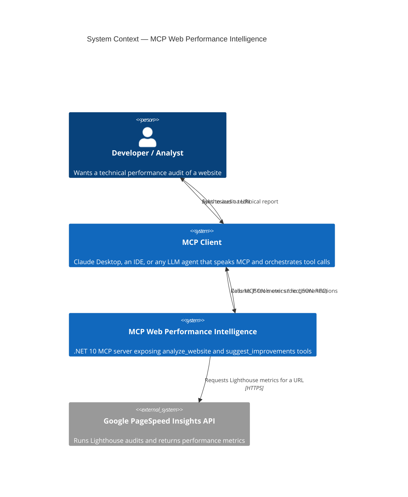
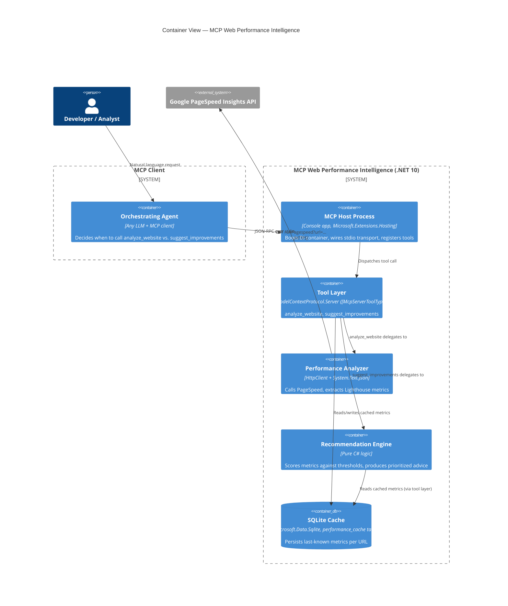
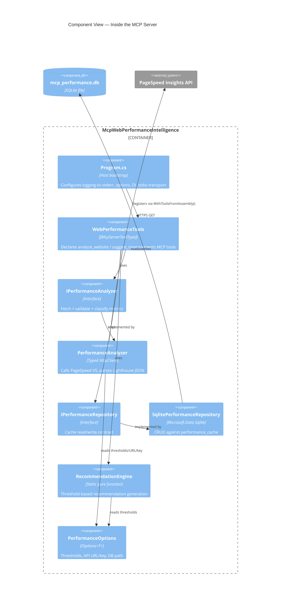
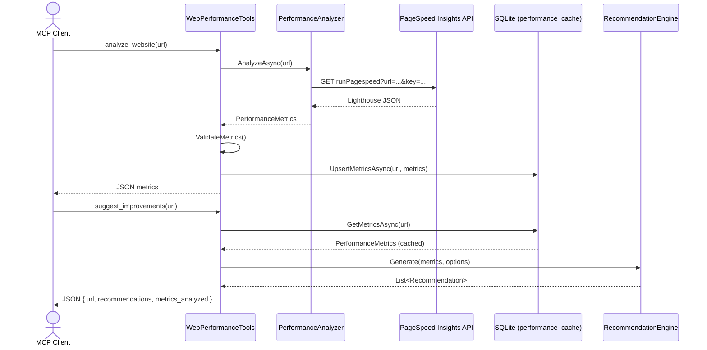

# Architecture (C4 Model)

This document describes the .NET MCP server using the [C4 model](https://c4model.com/):
Context, Container, and Component views, followed by the end-to-end request flow for
the two MCP tools the server exposes.

## Level 1 — System Context

Who/what talks to the system, and why.

**Key point:** the server is model-agnostic. The original proof of concept hard-wired
Gemini as the orchestrator; as a standard MCP server, any MCP-speaking client or model
can discover and call these same two tools.

## Level 2 — Container

## Level 3 — Component (Tool Layer)

## Request Flow — Two-Step Audit

## Mapping from the Original Python Proof of Concept

| Python (notebook / deleted `src/`)        | .NET equivalent                                         |
|--------------------------------------------|-----------------------------------------------------------|
| `FastMCP("WebPerformanceAnalyzer")`        | `AddMcpServer().WithStdioServerTransport()` (Program.cs)  |
| `@mcp.tool() def analyze_website`          | `[McpServerTool(Name="analyze_website")]` on `WebPerformanceTools` |
| `@mcp.tool() def suggest_improvements`     | `[McpServerTool(Name="suggest_improvements")]` on `WebPerformanceTools` |
| `PerformanceAnalyzer` (httpx + Lighthouse parsing) | `PerformanceAnalyzer` (typed `HttpClient` + `System.Text.Json`) |
| `PerformanceDatabase` (sqlite3)            | `SqlitePerformanceRepository` (Microsoft.Data.Sqlite)    |
| `_generate_recommendations()`              | `RecommendationEngine.Generate()`                        |
| `Config` class                             | `PerformanceOptions` (bound from `appsettings.json` + env vars) |
| Gemini `PerformanceAgent` orchestrator     | *Not ported* — any MCP client now plays this role instead of a Gemini-specific wrapper |
